<div align="center">


<br />

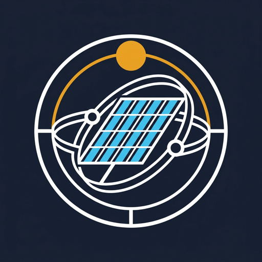

# Dual-Axis Solar Tracker

**Small-scale hybrid dual-axis solar tracker combining astronomical solar equations (NOAA) with automatic LDR quadrant calibration on Arduino.**

**Language:** [Español](README.md) | **English**

[](LICENSE)
[](firmware/original/control_ldr_con_solar_ec__Felix/control_ldr_con_solar_ec__Felix.ino)
[](docs/memoria-orientador-solar-ies-felix.pdf)

</div>

---

## Overview

A dual-axis solar tracker keeps a photovoltaic surface perpendicular to incoming solar radiation throughout the day and across seasons, increasing energy yield by **30 % to 45 %** compared to fixed-tilt installations.

This repository documents a **small-scale dual-axis solar tracker** developed during the **2022/23 Bachillerato de Investigación y Excelencia** program by **IES Félix Rodríguez de la Fuente** and **Universidad de Burgos (SWIFT Group)**. Rather than relying exclusively on optical feedback or open-loop ephemeris calculations, the controller combines both approaches:

1. **Compass-free optical auto-calibration**: at startup, four Light-Dependent Resistors (LDRs) arranged in a cross-separated quadrant head steer both servos until illumination is balanced across top/bottom and left/right pairs.
2. **Astronomical solar tracking**: once perpendicular to the sun, the firmware records that mechanical posture and computes solar **azimuth** and **elevation** via NOAA solar equations using geographic coordinates, date, and time, updating the servos relative to the calibrated reference.

| Finished Physical Prototype | Full 3D CAD Assembly |
| :---: | :---: |
| 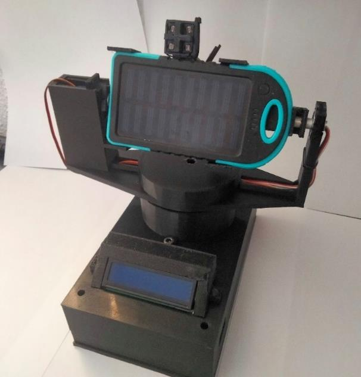 | 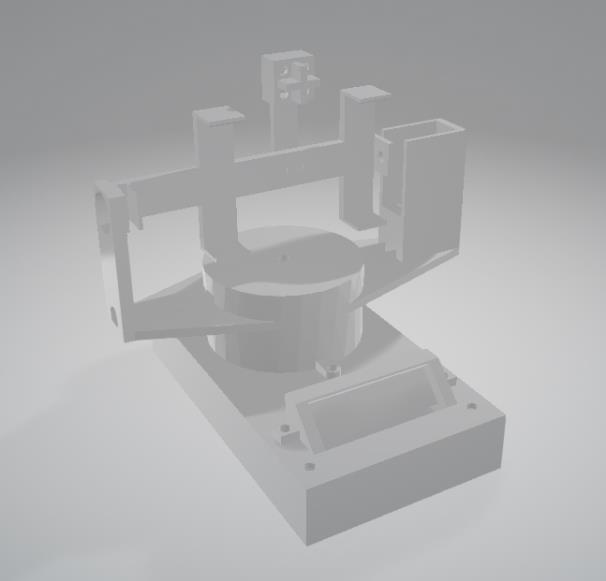 |

---

## System Architecture

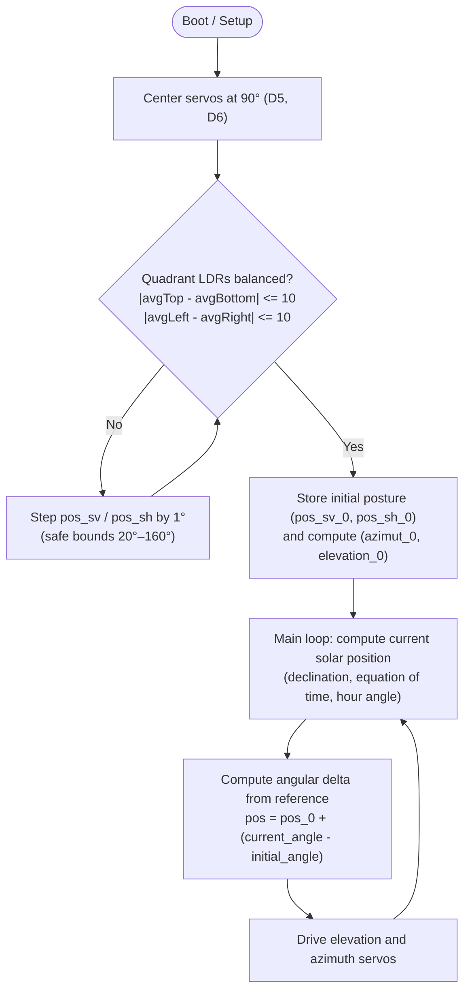

---

## Theoretical Background & Diagrams

The astronomical calculation follows **NOAA General Solar Position Calculations**. From day-of-year ($N$) and local time ($h$), the algorithm computes **solar declination ($\delta$)**, the **equation of time ($\Delta t$)**, and **true solar time ($tst$)** to derive solar **elevation** and **azimuth** for any latitude and longitude.

<table>
  <tr>
    <td align="center" width="50%">
      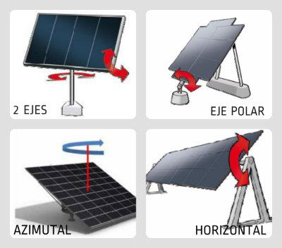
      <br />
      <sub>Comparison of single-axis (polar, azimuthal, horizontal) and dual-axis solar trackers.</sub>
    </td>
    <td align="center" width="50%">
      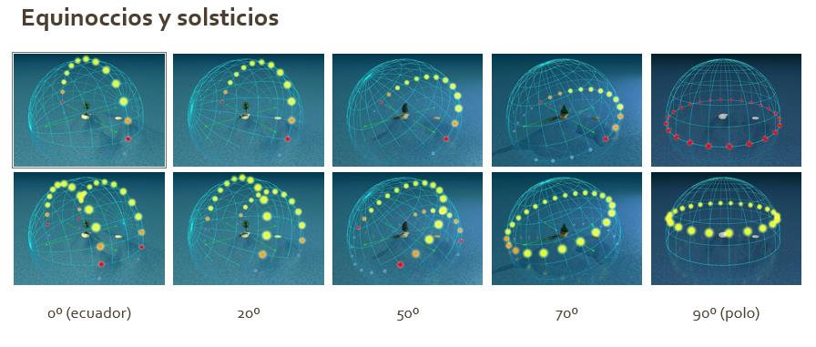
      <br />
      <sub>Apparent solar paths between solstices and equinoxes across latitudes.</sub>
    </td>
  </tr>
  <tr>
    <td align="center" width="50%">
      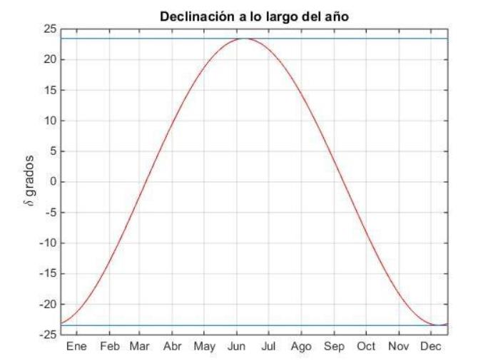
      <br />
      <sub>Annual variation of solar declination ($\delta \in [-23.45^\circ, +23.45^\circ]$).</sub>
    </td>
    <td align="center" width="50%">
      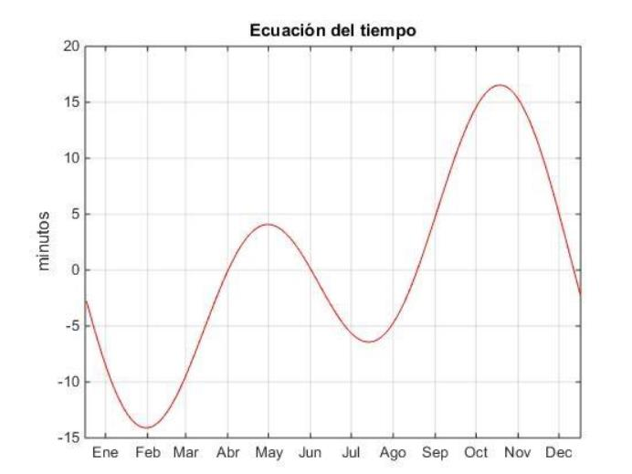
      <br />
      <sub>Equation of time fluctuation ($\Delta t$ in minutes) over the year.</sub>
    </td>
  </tr>
</table>

The full mathematical derivation (in Spanish) is available in [docs/modelo-matematico.md](docs/modelo-matematico.md).

---

## Hardware & Pinout

### Main Components

| Category | Components |
|---|---|
| **Controller** | Arduino Uno board (ATmega328P) |
| **Sensors** | 4x Photoresistors (LDRs) in voltage-divider quadrant configuration |
| **Actuators** | 2x Servo motors (horizontal azimuth axis + vertical elevation axis) |
| **Time & UI** *(report)* | I2C Real-Time Clock (RTC) module, 16x2 LCD display, I2C backpack |
| **Mechanics** | 9x PLA+ 3D-printed parts, 1x 22x8 mm bearing, 8 mm aluminum tube, 9x M8 hex bolts |

### Arduino Uno Pinout

| Arduino Pin | Signal Type | Connected Component |
|---|---|---|
| `A0` – `A3` | Analog input | 4x LDRs (`TOP_LEFT`, `TOP_RIGHT`, `BOTTOM_LEFT`, `BOTTOM_RIGHT`) |
| `A4` (`SDA`) / `A5` (`SCL`) | I2C bus | RTC module + I2C adapter for 16x2 LCD |
| `D5` | Digital PWM | Vertical servo motor (elevation, software limits `20°`–`160°`) |
| `D6` | Digital PWM | Horizontal servo motor (azimuth, software limits `20°`–`160°`) |

> [!IMPORTANT]
> Power the servo motors from a **dedicated external power supply** sharing common ground (`GND`) with the Arduino. During early prototyping tests documented in the report, powering servos improperly from the board damaged part of the electronics.

For the full Bill of Materials (BOM) and wiring diagram, see [docs/hardware-y-conexiones.md](docs/hardware-y-conexiones.md).

---

## Mechanical Design (3D Printing)

The frame consists of **9 custom 3D-printed PLA+ parts**, engineered with internal wire channels and an aluminum counter-support tube so cables do not snag during dual-axis rotation.

<details>
<summary>View all 9 CAD parts extracted from the technical report</summary>

<br />

| 1. Base Plate | 2. Electronics Cover | 3. Axis 1 Mount (Azimuth) |
| :---: | :---: | :---: |
| 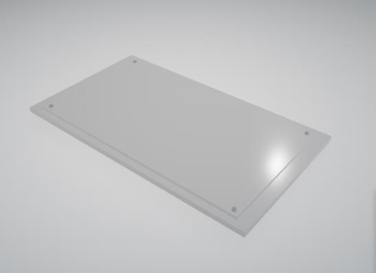 | 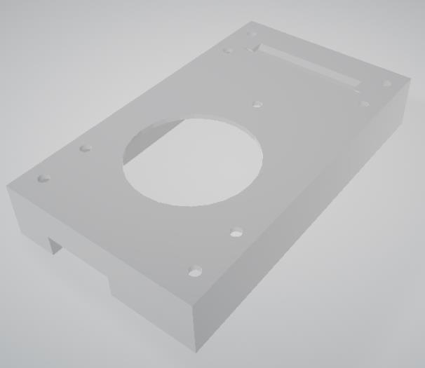 | 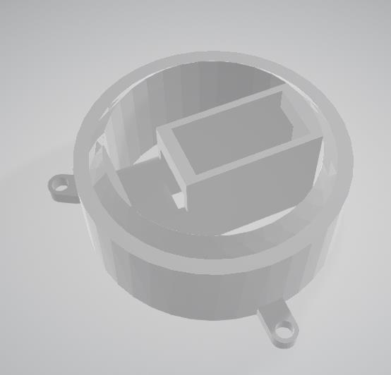 |
| **4. Axis 2 Mount (Elevation)** | **5. Solar Panel Bracket** | **6. LCD Stand (45°)** |
| 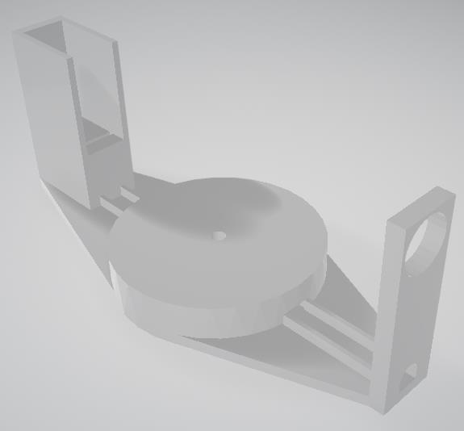 | 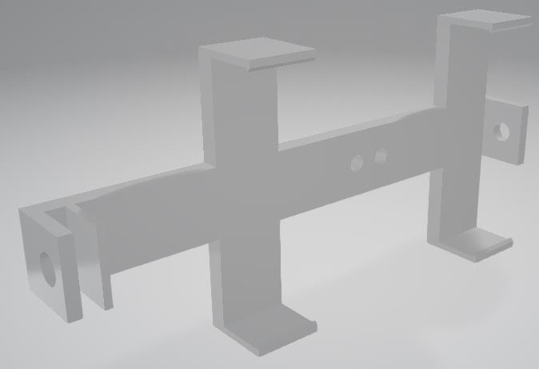 | 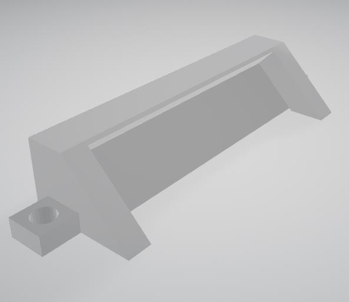 |
| **7. LDR Arm** | **8. LDR Cross Separator** | **9. Enclosure Extender (+2 cm)** |
| 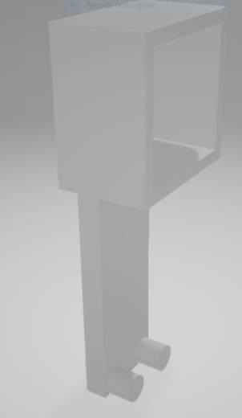 | 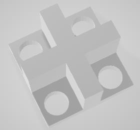 | 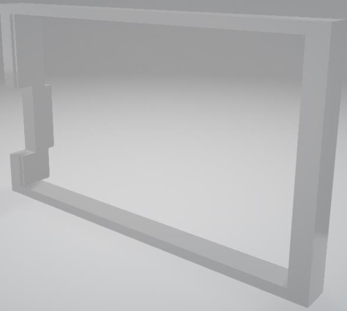 |

</details>

> [!NOTE]
> The `.stl` source files mentioned in the appendix of the PDF report are not currently included in this repository. Assembly notes, bearing/hardware specifications, and lessons learned are documented in [docs/montaje-y-calibracion.md](docs/montaje-y-calibracion.md).

---

## Firmware & Quick Start

The repository preserves the original `.ino` sketch untouched and provides a cleaned, documented reference version:

- **Original sketch**: [`firmware/original/control_ldr_con_solar_ec__Felix/control_ldr_con_solar_ec__Felix.ino`](firmware/original/control_ldr_con_solar_ec__Felix/control_ldr_con_solar_ec__Felix.ino)
- **Cleaned reference sketch**: [`firmware/reference/solar_tracker_hybrid/solar_tracker_hybrid.ino`](firmware/reference/solar_tracker_hybrid/solar_tracker_hybrid.ino)

### Build & Upload

1. Open Arduino IDE (1.8.x or 2.x).
2. Open `firmware/reference/solar_tracker_hybrid/solar_tracker_hybrid.ino`.
3. Configure your geographic location and initial date/time constants:
   - `LATITUD_DEG` and `LONGITUD_DEG` (default: Burgos, Spain — `42.350975, -3.688766`).
   - `TIMEZONE_UTC` (`2` for CEST).
   - `diaDelAno`, `hora`, `minuto`, `segundo`.
4. Select **Arduino Uno** and your serial port.
5. Compile, upload, and open the Serial Monitor at `9600` baud to inspect initial calibration and target servo angles.

> [!NOTE]
> While the PDF report describes RTC and I2C 16x2 LCD integration (~270 lines in the final school build), the preserved `.ino` file in this repository is a 193-line variant focused on hybrid LDR calibration + solar equations with static time variables. The reference sketch fixes radian/degree unit mismatches in `solar_ec` and enforces servo safety bounds in `loop()`.

---

## Repository Structure

```text
.
├── assets/
│   ├── branding/                          # Repository icon and header banner
│   └── images/
│       ├── cad/                           # 9 CAD part views extracted from the PDF
│       ├── diagrams/                      # Solar geometry diagrams from the report
│       ├── prototype-3d-assembly.png      # Full 3D CAD assembly render
│       └── prototype-final.png            # Photograph of the completed prototype
├── docs/
│   ├── memoria-orientador-solar-ies-felix.pdf  # Full technical report (28 pages, ES)
│   ├── hardware-y-conexiones.md           # BOM, pinout, and power warnings (ES)
│   ├── modelo-matematico.md               # NOAA equations and code review notes (ES)
│   └── montaje-y-calibracion.md           # 3D parts catalog and assembly guide (ES)
├── firmware/
│   ├── original/control_ldr_con_solar_ec__Felix/
│   │   └── control_ldr_con_solar_ec__Felix.ino # Original untouched Arduino sketch
│   └── reference/solar_tracker_hybrid/
│       └── solar_tracker_hybrid.ino       # Cleaned & unit-fixed reference sketch
├── CITATION.cff                           # Academic citation metadata
├── LICENSE                                # GNU GPL v3.0 license
├── README.md                              # Main documentation (Spanish)
└── README.en.md                           # Documentation (English)
```

---

## Credits & Acknowledgments

- **Authors**: Jorge Sáinz Vidal, Alberto Cuervo Prieto
- **Project Advisor**: Gregorio Gómez Pérez
- **Institutions**: IES Félix Rodríguez de la Fuente, Universidad de Burgos (SWIFT Group) — *Bachillerato de Investigación y Excelencia, 2022/23*

## License

Licensed under the **GNU General Public License v3.0 (GPL-3.0)**. See [LICENSE](LICENSE) for full terms.
