<div align="center">


<br />

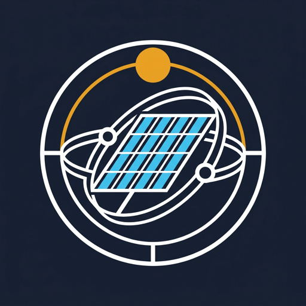

# Orientador Solar de Doble Eje

**Prototipo híbrido de seguimiento solar en dos ejes basado en ecuaciones astronómicas (NOAA) y autocalibración por fotorresistencias (LDR) sobre Arduino.**

**Idioma:** **Español** | [English](README.en.md)

[](LICENSE)
[](firmware/original/control_ldr_con_solar_ec__Felix/control_ldr_con_solar_ec__Felix.ino)
[](docs/memoria-orientador-solar-ies-felix.pdf)

</div>

---

## Descripción general

Un seguidor solar de dos ejes mantiene la superficie fotovoltaica perpendicular a la radiación solar a lo largo de todo el día y de las distintas estaciones, incrementando la captación energética entre un **30 % y un 45 %** frente a una instalación fija.

Este proyecto implementa un **orientador solar a pequeña escala** desarrollado en el marco del **Bachillerato de Investigación y Excelencia (curso 2022/23)** entre el **IES Félix Rodríguez de la Fuente** y la **Universidad de Burgos (Grupo SWIFT)**. A diferencia de los seguidores convencionales basados únicamente en sensores ópticos o únicamente en efemérides, el sistema combina ambos enfoques:

1. **Autocalibración inicial sin brújula**: al arrancar, cuatro fotorresistencias (LDR) separadas por una cruceta orientan automáticamente el panel hasta igualar la incidencia lumínica en ambos ejes.
2. **Seguimiento astronómico por ecuaciones solares**: una vez alineado con el Sol, el controlador calcula la posición solar (azimut y elevación) mediante las ecuaciones de la NOAA a partir de la latitud, la longitud, la fecha y la hora, desplazando los servomotores de forma relativa a la postura calibrada.

| Prototipo físico finalizado | Ensamblaje CAD completo |
| :---: | :---: |
| 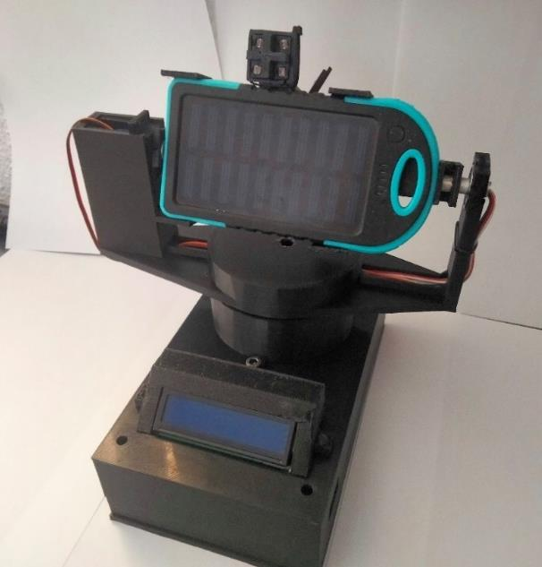 | 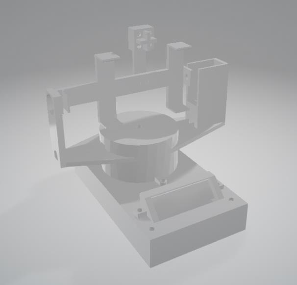 |

---

## Arquitectura del sistema

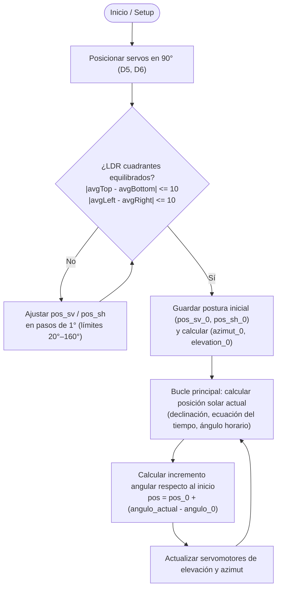

---

## Fundamento teórico y diagramas

El cálculo astronómico implementado sigue el modelo de la **NOAA (*General Solar Position Calculations*)**. A partir del número de día del año y la hora local, el sistema determina la **declinación solar ($\delta$)**, la **ecuación del tiempo ($\Delta t$)** y la **hora solar verdadera**, obteniendo finalmente los ángulos de **elevación** y **azimut** para cualquier coordenada geográfica.

<table>
  <tr>
    <td align="center" width="50%">
      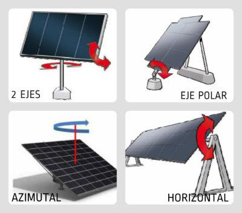
      <br />
      <sub>Comparativa de seguidores de 1 eje (polar, azimutal, horizontal) y 2 ejes.</sub>
    </td>
    <td align="center" width="50%">
      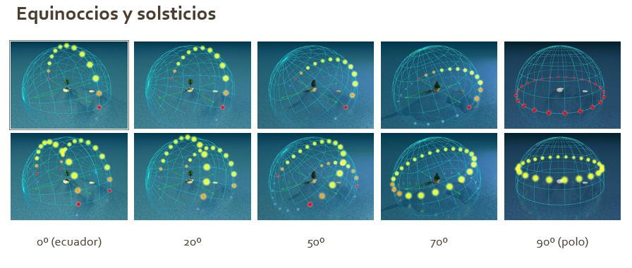
      <br />
      <sub>Trayectoria solar aparente entre solsticios y equinoccios según latitud.</sub>
    </td>
  </tr>
  <tr>
    <td align="center" width="50%">
      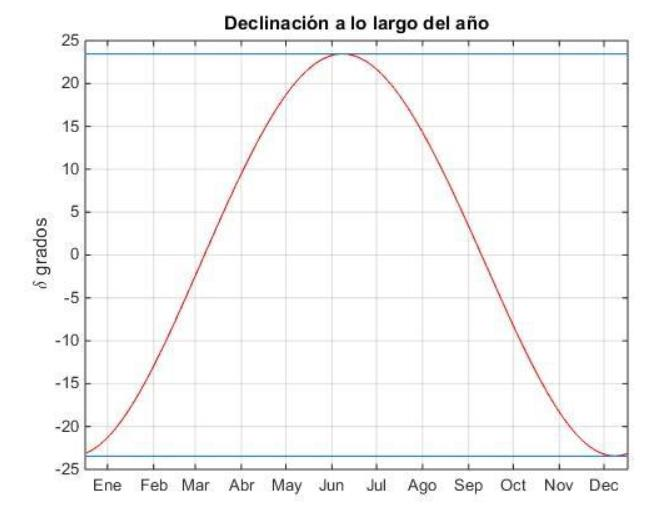
      <br />
      <sub>Variación anual de la declinación solar ($\delta \in [-23.45^\circ, +23.45^\circ]$).</sub>
    </td>
    <td align="center" width="50%">
      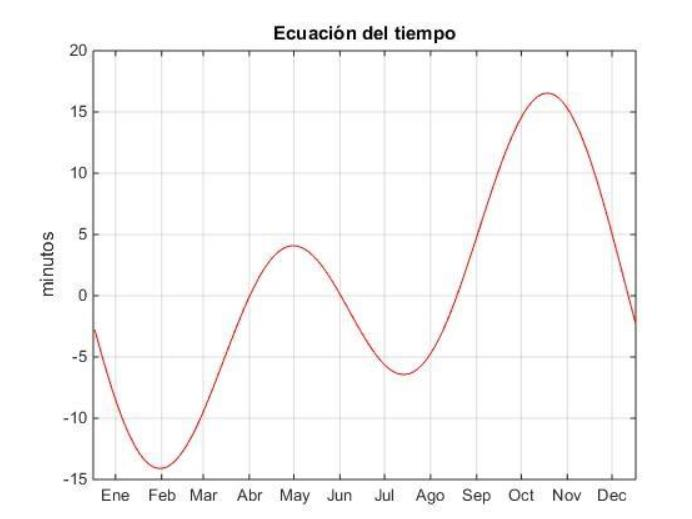
      <br />
      <sub>Fluctuación de la ecuación del tiempo ($\Delta t$ en minutos) durante el año.</sub>
    </td>
  </tr>
</table>

La derivación completa de las ecuaciones puede consultarse en [docs/modelo-matematico.md](docs/modelo-matematico.md).

---

## Hardware y conexiones

### Componentes principales

| Categoría | Componentes |
|---|---|
| **Control** | Placa Arduino Uno (ATmega328P) |
| **Sensores** | 4x Fotorresistencias (LDR) con divisores resistivos en cuadrante |
| **Actuadores** | 2x Servomotores (eje horizontal/azimut y eje vertical/elevación) |
| **Tiempo e interfaz** *(memoria)* | Módulo reloj RTC (I2C), pantalla LCD 16x2 y conversor I2C |
| **Mecánica** | 9 piezas impresas en PLA+, 1 rodamiento 22x8 mm, tubo de aluminio de 8 mm, 9 tornillos M8 |

### Mapa de pines

| Pin Arduino | Función | Componente |
|---|---|---|
| `A0` – `A3` | Entradas analógicas | 4x LDR (`TOP_LEFT`, `TOP_RIGHT`, `BOTTOM_LEFT`, `BOTTOM_RIGHT`) |
| `A4` (`SDA`) / `A5` (`SCL`) | Bus I2C | Módulo RTC + Conversor I2C para LCD 16x2 |
| `D5` | Salida PWM | Servomotor vertical (elevación, rango seguro `20°`–`160°`) |
| `D6` | Salida PWM | Servomotor horizontal (azimut, rango seguro `20°`–`160°`) |

> [!IMPORTANT]
> Alimenta los servomotores mediante una **fuente externa independiente** con masa (`GND`) compartida con la placa Arduino. Durante las pruebas iniciales descritas en la memoria, una alimentación inadecuada de los servos desde la placa dañó parte de la electrónica.

Consulta la lista completa de materiales (BOM) y el diagrama de cableado en [docs/hardware-y-conexiones.md](docs/hardware-y-conexiones.md).

---

## Diseño mecánico (impresión 3D)

La estructura está compuesta por **9 piezas diseñadas en 3D e impresas en PLA+**, pensadas para ocultar el cableado interno a través del eje de giro y el tubo de aluminio del contrapunto.

<details>
<summary>Ver galería de las 9 piezas CAD extraídas de la memoria</summary>

<br />

| 1. Planta / Base | 2. Cubre componentes | 3. Soporte eje 1 (Azimut) |
| :---: | :---: | :---: |
| 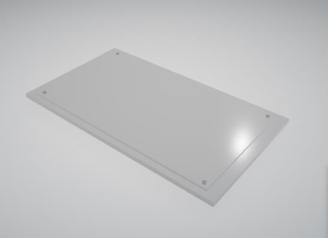 | 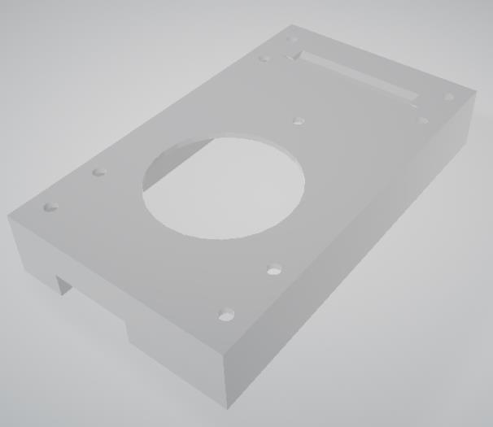 | 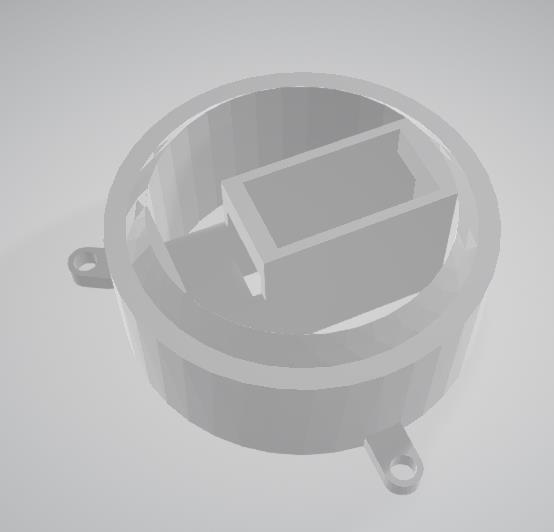 |
| **4. Soporte eje 2 (Elevación)** | **5. Soporte panel solar** | **6. Soporte pantalla LCD** |
| 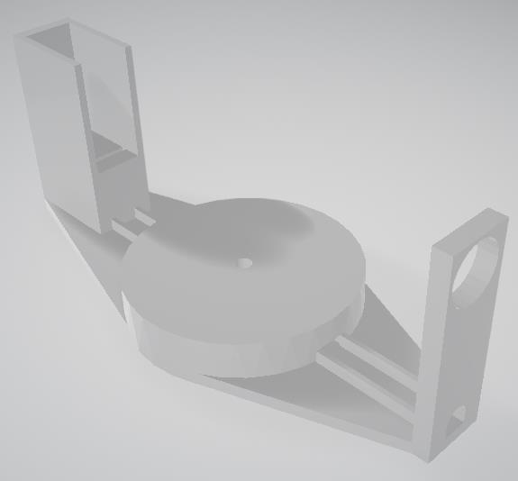 | 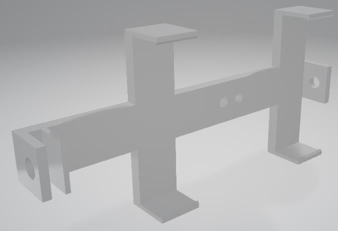 | 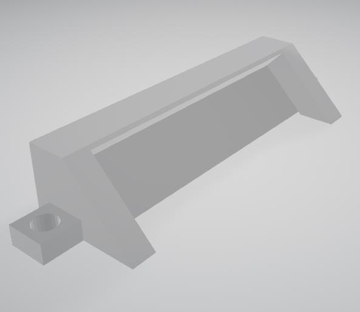 |
| **7. Soporte LDR (Brazo)** | **8. Soporte LDR (Separador)** | **9. Ampliador (+2 cm)** |
| 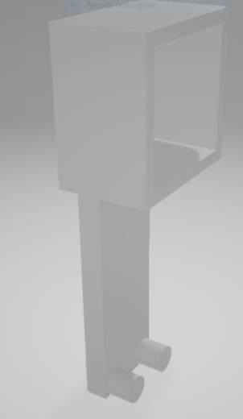 | 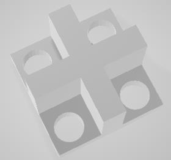 | 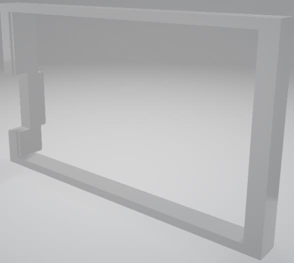 |

</details>

> [!NOTE]
> Los archivos fuente `.stl` mencionados en el apartado de anexos de la memoria PDF no se encuentran actualmente en este repositorio. Toda la descripción dimensional y las notas de montaje están documentadas en [docs/montaje-y-calibracion.md](docs/montaje-y-calibracion.md).

---

## Firmware y puesta en marcha

El repositorio conserva el código original sin modificaciones y ofrece una versión de referencia corregida y documentada:

- **Original**: [`firmware/original/control_ldr_con_solar_ec__Felix/control_ldr_con_solar_ec__Felix.ino`](firmware/original/control_ldr_con_solar_ec__Felix/control_ldr_con_solar_ec__Felix.ino)
- **Referencia corregida**: [`firmware/reference/solar_tracker_hybrid/solar_tracker_hybrid.ino`](firmware/reference/solar_tracker_hybrid/solar_tracker_hybrid.ino)

### Pasos para compilar y cargar

1. Abre Arduino IDE (1.8.x o 2.x).
2. Abre `firmware/reference/solar_tracker_hybrid/solar_tracker_hybrid.ino` (o el sketch original si deseas revisar la versión histórica).
3. Ajusta tus coordenadas geográficas y fecha/hora iniciales:
   - `LATITUD_DEG` y `LONGITUD_DEG` (por defecto: Burgos, `42.350975, -3.688766`).
   - `TIMEZONE_UTC` (`2` para horario de verano en España peninsular).
   - `diaDelAno`, `hora`, `minuto`, `segundo`.
4. Selecciona la placa **Arduino Uno** y el puerto serie correspondiente.
5. Compila, carga el programa y abre el Monitor Serie a `9600` baudios para verificar la calibración inicial y las consignas de los servos.

> [!NOTE]
> La memoria escrita describe la integración de un reloj RTC y una pantalla LCD 16x2 I2C (aprox. 270 líneas en la versión final allí citada). El archivo `.ino` conservado en el repositorio corresponde a una variante de 193 líneas centrada en el control híbrido LDR + ecuaciones solares con hora inicial fija. La versión de referencia corrige inconsistencias de unidades en `solar_ec` y aplica límites mecánicos en `loop()`.

---

## Estructura del repositorio

```text
.
├── assets/
│   ├── branding/                          # Icono y banner del repositorio
│   └── images/
│       ├── cad/                           # Vistas CAD de las 9 piezas impresas en 3D
│       ├── diagrams/                      # Diagramas solares extraídos de la memoria
│       ├── prototype-3d-assembly.png      # Render del conjunto ensamblado
│       └── prototype-final.png            # Fotografía del prototipo físico
├── docs/
│   ├── memoria-orientador-solar-ies-felix.pdf  # Memoria completa del proyecto (28 págs.)
│   ├── hardware-y-conexiones.md           # BOM, mapa de pines y advertencias eléctricas
│   ├── modelo-matematico.md               # Ecuaciones NOAA y análisis del algoritmo
│   └── montaje-y-calibracion.md           # Guía de piezas 3D, montaje e incidencias
├── firmware/
│   ├── original/control_ldr_con_solar_ec__Felix/
│   │   └── control_ldr_con_solar_ec__Felix.ino # Sketch original conservado
│   └── reference/solar_tracker_hybrid/
│       └── solar_tracker_hybrid.ino       # Sketch de referencia limpio y corregido
├── CITATION.cff                           # Metadatos de citación académica
├── LICENSE                                # Licencia GNU GPL v3.0
├── README.md                              # Documentación principal (español)
└── README.en.md                           # Documentation in English
```

---

## Autoría y agradecimientos

- **Autores**: Jorge Sáinz Vidal, Alberto Cuervo Prieto
- **Tutor del proyecto**: Gregorio Gómez Pérez
- **Instituciones y colaboración**: IES Félix Rodríguez de la Fuente, Universidad de Burgos (Grupo SWIFT) — *Bachillerato de Investigación y Excelencia, Curso 2022/23*

## Licencia

Este proyecto se distribuye bajo la licencia **GNU General Public License v3.0 (GPL-3.0)**. Consulta el archivo [LICENSE](LICENSE) para más detalles.
