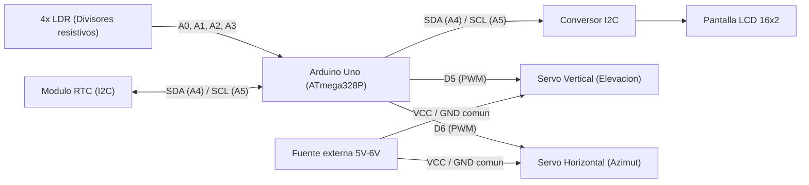

# Hardware, Lista de Materiales (BOM) y Conexiones

Este documento recopila los componentes electrónicos y mecánicos descritos en la [memoria del proyecto](./memoria-orientador-solar-ies-felix.pdf), junto con el mapa de conexiones para la placa Arduino y las lecciones aprendidas durante el montaje.

## 1. Lista de materiales (BOM)

### Electrónica

| Cantidad | Componente | Función en el sistema | Notas |
|---:|---|---|---|
| 1 | Placa Arduino Uno (ATmega328P) | Controlador principal | Lógica 5 V, 6 entradas analógicas y bus I2C |
| 4 | Fotorresistencias (LDR) | Sensor cuadrante de luz solar | De ~100 ohm (luz) a ~1 Mohm (oscuridad) |
| 4 | Resistencias (p. ej. 10 kohm) | Divisor de tensión para cada LDR | Necesarias para lectura analógica estable en `A0`-`A3` |
| 2 | Servomotores | Accionamiento de azimut y elevación | Uno en base (azimut) y otro en brazo (elevación) |
| 1 | Módulo reloj en tiempo real (RTC) | Mantenimiento de fecha y hora sin alimentación | Interfaz I2C con pila de botón (referido en la memoria) |
| 1 | Pantalla LCD 16x2 | Visualización de ángulos de azimut y elevación | 16 columnas x 2 filas (referida en la memoria) |
| 1 | Módulo conversor I2C (PCF8574) | Reducción de pines para la pantalla LCD | Permite usar el LCD mediante `SDA`/`SCL` sin ocupar pines PWM |
| 1 | Interruptor | Corte general de alimentación | Alojado en el lateral del cubrecomponentes |
| 1 | Protoboard y cableado flexible | Interconexión de sensores, alimentación y bus I2C | Se recomiendan cables largos y flexibles para el giro |
| 1 | Fuente de alimentación externa para servos | Alimentación independiente de los motores | Crítico: ver sección de advertencias eléctricas |

### Mecánica y fabricación 3D

| Cantidad | Elemento | Especificación |
|---:|---|---|
| 9 | Piezas impresas en 3D | Impresas en PLA+ (ver [guía de montaje](./montaje-y-calibracion.md)) |
| 1 | Rodamiento | 22 x 8 mm (contrapunto del eje de elevación) |
| 9 | Tornillos hexagonales | Métrica M8 |
| 1 | Tubo de aluminio | Diámetro exterior compatible con interior de 8 mm del rodamiento |

---

## 2. Mapa de pines (Arduino Uno / ATmega328P)

El firmware del proyecto (`control_ldr_con_solar_ec__Felix.ino`) y la memoria técnica asignan los puertos de la siguiente forma:

| Pin Arduino | Tipo | Componente conectado | Observaciones |
|---|---|---|---|
| `A0` | Entrada analógica | LDR superior izquierda (`LDR_TOP_LEFT`) | Divisor resistivo |
| `A1` | Entrada analógica | LDR superior derecha (`LDR_TOP_RIGHT`) | Divisor resistivo |
| `A2` | Entrada analógica | LDR inferior izquierda (`LDR_BOTTOM_LEFT`) | Divisor resistivo |
| `A3` | Entrada analógica | LDR inferior derecha (`LDR_BOTTOM_RIGHT`) | Divisor resistivo |
| `A4` (`SDA`) | Bus I2C | RTC + Conversor I2C del LCD 16x2 | Compartido por dirección I2C |
| `A5` (`SCL`) | Bus I2C | RTC + Conversor I2C del LCD 16x2 | Compartido por dirección I2C |
| `D5` | Digital PWM | Servomotor vertical (elevación) | Límites software: 20° a 160° |
| `D6` | Digital PWM | Servomotor horizontal (azimut) | Límites software: 20° a 160° |

> Nota sobre el firmware conservado en el repositorio: el archivo [control_ldr_con_solar_ec__Felix.ino](../firmware/original/control_ldr_con_solar_ec__Felix/control_ldr_con_solar_ec__Felix.ino) implementa la lectura de las 4 LDR en `A0`-`A3` y el control de ambos servos en `D5` y `D6`, con fecha y hora definidas como variables iniciales. Aunque incluye `#include <LiquidCrystal.h>`, la lógica activa de lectura del módulo RTC y escritura en el LCD I2C descrita en la memoria (aprox. 270 líneas según el documento) no forma parte de ese archivo concreto.

---

## 3. Esquema lógico de conexiones

---

## 4. Advertencias eléctricas y lecciones del prototipo

De acuerdo con el apartado 4 (*Análisis e interpretación de resultados*) de la memoria:

1. **Alimentación de los servomotores**: Durante las primeras pruebas, una alimentación incorrecta de los motores dañó parte de la electrónica. No alimentes los dos servomotores directamente desde el regulador de 5 V de la placa Arduino; utiliza una fuente externa adecuada compartiendo masa (`GND`) con el Arduino.
2. **Par de los servomotores**: Los autores sustituyeron los servos iniciales por otros de menor par pero con las mismas dimensiones físicas para mantener la compatibilidad sin rediseñar la estructura 3D.
3. **Longitud y flexibilidad del cableado**: Los cables que suben desde la base hacia el servo de elevación y el cabezal de LDR atraviesan ranuras internas y el tubo de aluminio. Usa cables largos y flexibles para evitar tirones o desconexiones durante los giros de azimut y elevación.
