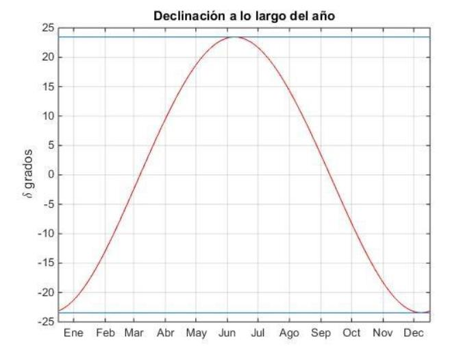
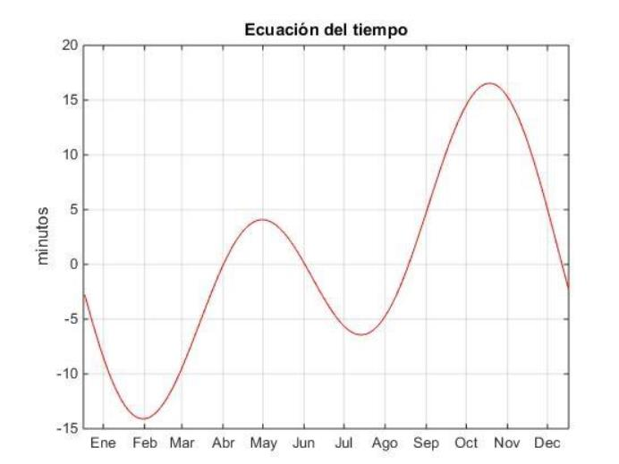

# Modelo Matemático y Algoritmo de Seguimiento Híbrido

El orientador combina dos estrategias complementarias: **autocalibración óptica inicial** mediante cuatro fotorresistencias (LDR) y **seguimiento astronómico predictivo** basado en las ecuaciones solares publicadas por la NOAA (*General Solar Position Calculations*).

## 1. Estrategia híbrida: por qué combinar LDR y ecuaciones solares

Un seguidor puramente óptico pierde precisión en días nublados o ante sombras puntuales, mientras que un seguidor puramente astronómico exige orientar manualmente la base exactamente hacia el Norte/Sur geográfico al instalarlo.

Este proyecto resuelve ambas limitaciones en dos fases:

1. **Fase de calibración automática (`setup`)**: El sistema lee las 4 LDR dispuestas en cuadrantes separados por una cruceta opaca y mueve ambos ejes paso a paso hasta igualar la luminosidad entre arriba/abajo e izquierda/derecha (dentro del umbral `LIGHT_THRESHOLD = 10`).
2. **Fase de seguimiento solar (`loop`)**: Una vez perpendicular al Sol, el sistema guarda la posición angular de los servos (`pos_sv_0`, `pos_sh_0`) y calcula la posición solar inicial (`elevation_0`, `azimut_0`). A partir de ahí, calcula en cada ciclo el incremento angular solar ($\Delta\text{elevación}$, $\Delta\text{azimut}$) y actualiza los servos respecto a la referencia inicial, sin requerir brújula ni nivelación manual previa.

---

## 2. Ecuaciones solares (NOAA)

Sea $N$ el día del año (`diaDelAno`, $1 \dots 365$) y $h$ la hora local en formato decimal.

### 2.1 Ángulo fraccional del año ($\gamma$)

$$\gamma = \frac{2\pi}{365} \left( N - 1 + \frac{h - 12}{24} \right)$$

*(Nota: en el firmware original se utiliza la forma simplificada $\gamma = \frac{2\pi}{365}(N - 1)$; en el firmware de referencia se incluye la corrección horaria recogida en la memoria).*

### 2.2 Declinación solar ($\delta$, en radianes)

$$\delta = 0.006918 - 0.399912\cos(\gamma) + 0.070257\sin(\gamma) - 0.006758\cos(2\gamma) + 0.000907\sin(2\gamma) - 0.002697\cos(3\gamma) + 0.001480\sin(3\gamma)$$

  

### 2.3 Ecuación del tiempo ($\Delta t$, en minutos)

Mide la discrepancia entre el tiempo solar aparente y el tiempo solar medio debida a la excentricidad orbital y la oblicuidad de la eclíptica:

$$\Delta t = 229.18 \cdot \big(0.000075 + 0.001868\cos(\gamma) - 0.032077\sin(\gamma) - 0.014615\cos(2\gamma) - 0.040849\sin(2\gamma)\big)$$

  

### 2.4 Hora solar verdadera y ángulo horario

A partir de la longitud geográfica ($\lambda$, en grados, negativa al Oeste) y el huso horario respecto a UTC ($TZ$):

$$\text{time\_offset} = \Delta t + 4\lambda - 60 \cdot TZ$$

$$tst = \text{hora} \cdot 60 + \text{minuto} + \frac{\text{segundo}}{60} + \text{time\_offset}$$

$$\text{hourAngle} = \frac{tst}{4} - 180^\circ$$

### 2.5 Elevación y azimut solar

Con la latitud $\phi$, el ángulo cenital $\theta_z$ y la elevación solar $\alpha$ se obtienen mediante:

$$\cos(\theta_z) = \sin(\phi)\sin(\delta) + \cos(\phi)\cos(\delta)\cos(\text{hourAngle})$$

$$\alpha = \frac{\pi}{2} - \theta_z$$

Y el ángulo de azimut desde el Norte en sentido horario:

$$\cos(\psi_0) = -\frac{\sin(\phi)\cos(\theta_z) - \sin(\delta)}{\cos(\phi)\sin(\theta_z)}$$

$$\psi = \begin{cases} 360^\circ - \psi_0 & \text{si } \text{hourAngle} > 0 \\ \psi_0 & \text{si } \text{hourAngle} \le 0 \end{cases}$$

---

## 3. Observaciones sobre el código original vs. el firmware de referencia

Al revisar [control_ldr_con_solar_ec__Felix.ino](../firmware/original/control_ldr_con_solar_ec__Felix/control_ldr_con_solar_ec__Felix.ino), se identificaron tres detalles técnicos que se documentan y corrigen en [solar_tracker_hybrid.ino](../firmware/reference/solar_tracker_hybrid/solar_tracker_hybrid.ino):

1. **Unidades en `solar_ec`**: En las líneas 185 y 190 del sketch original se multiplicaban `zenitAngle` y `decl` por `DEG_TO_RAD` aunque ya estaban expresados en radianes, y en la línea 191 se sobrescribía `azimut` incondicionalmente tras el `if/else`. El firmware de referencia mantiene todas las operaciones trigonométricas en radianes y aplica `constrain(..., -1.0, 1.0)` para evitar valores fuera de dominio en `acos()`.
2. **Límites mecánicos en `loop()`**: En el sketch original se aplican `LOWER_LIMIT_POS` (20°) y `UPPER_LIMIT_POS` (160°) durante la calibración LDR, pero no en el `loop()`. El firmware de referencia limita también las consignas finales en `loop()`.
3. **Actualización horaria**: El sketch original fija `diaDelAno`, `hora`, `minuto` y `segundo` como constantes globales sin incrementar el reloj en tiempo real. Para seguimiento continuo autónomo se requiere integrar la lectura desde un módulo RTC (I2C) o un temporizador interno.
