# Diseño Mecánico, Montaje y Calibración

La estructura del prototipo fue diseñada en 3D y fabricada en plástico **PLA+** junto con tornillería estándar, un rodamiento para el contrapunto del eje de elevación y un tubo de aluminio para el guiado interno de cables.

> **Estado de los archivos 3D (.stl)**: Aunque el apartado 8 (*Anexos*) de la memoria menciona los archivos `.stl` del prototipo, dichos modelos no se encuentran incluidos actualmente en este repositorio. Se conservan aquí todas las vistas CAD extraídas de la memoria técnica y la guía de ensamblaje completa.

---

## 1. Catálogo de piezas impresas en 3D (9 partes)

| # | Pieza | Función | Vista CAD |
|---:|---|---|---|
| 1 | **Planta / Mesa** | Base inferior a dos alturas con 4 taladros para patas regulables; aloja Arduino y electrónica | 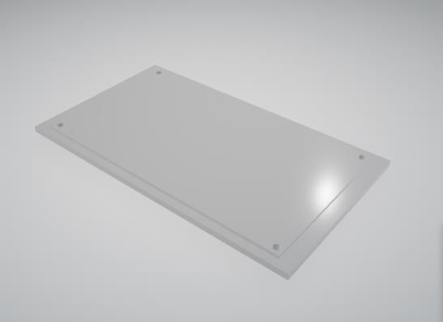 |
| 2 | **Cubre componentes** | Tapa estructural con vaciado circular para paso de cables, alojamiento frontal para LCD y orificios laterales para puertos e interruptor | 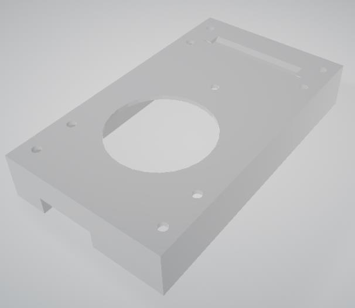 |
| 3 | **Soporte de eje 1 (Azimut)** | Aloja el servomotor horizontal con reducción cónica a 45° para giro fluido y ranuras de paso de cables | 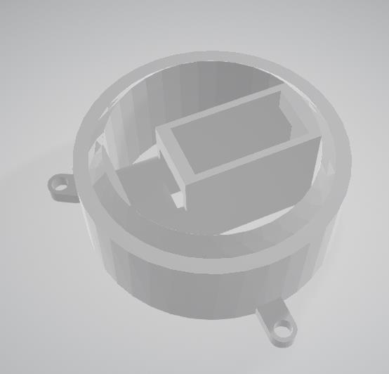 |
| 4 | **Soporte de eje 2 (Elevación)** | Sostiene el servo de elevación en un extremo y un contrapunto con rodamiento 22x8 mm en el opuesto | 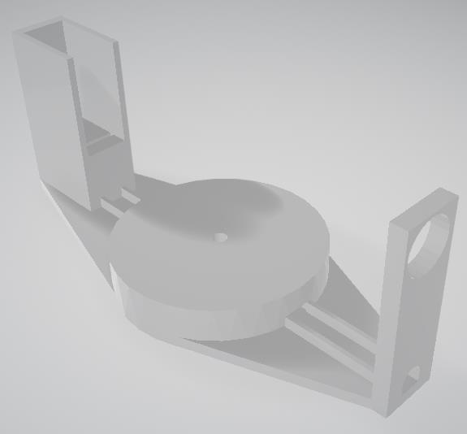 |
| 5 | **Soporte de panel solar** | Estructura en H con enganches para sujetar el panel, anclaje al tubo de aluminio y fijación para el brazo LDR | 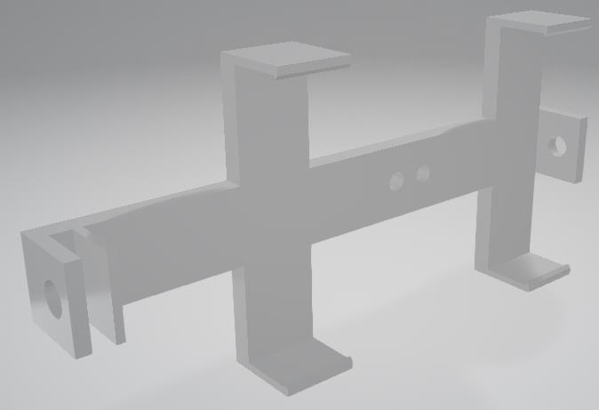 |
| 6 | **Soporte pantalla LCD** | Pieza inclinada a 45° que fija la pantalla LCD 16x2 y oculta su cableado hacia el interior de la caja | 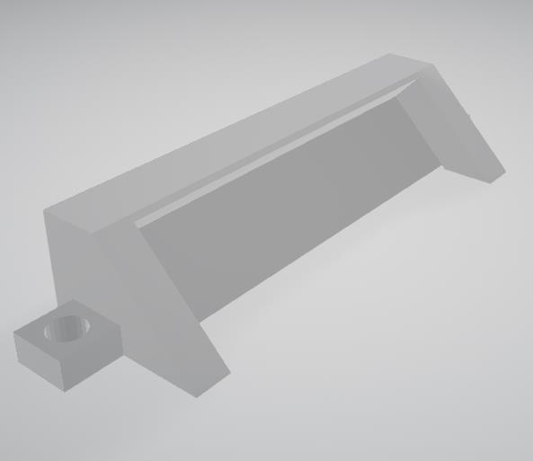 |
| 7 | **Soporte LDR (Brazo)** | Brazo vertical con dos pivotes de anclaje al soporte del panel y caja superior para el separador | 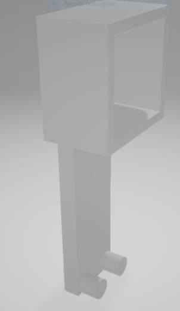 |
| 8 | **Soporte LDR (Separador)** | Cruceta con 4 alojamientos que aísla ópticamente cada LDR en los ejes X e Y | 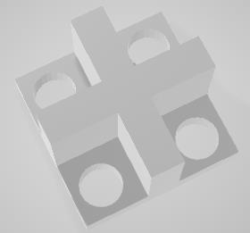 |
| 9 | **Ampliador** | Suplemento de +2 cm entre la planta y el cubrecomponentes para alojar el cableado entre Arduino y protoboard | 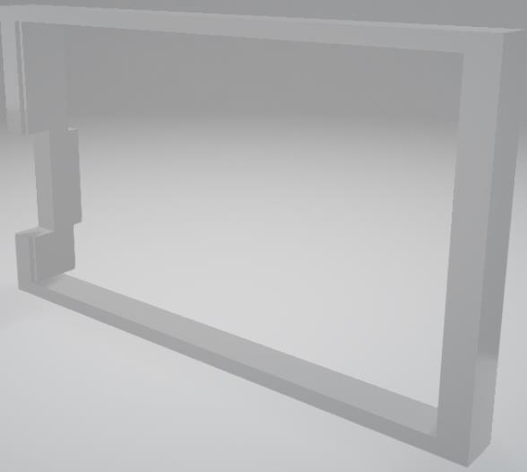 |

---

## 2. Conjunto ensamblado y prototipo físico

| Ensamblaje 3D completo | Prototipo finalizado |
|---|---|
| 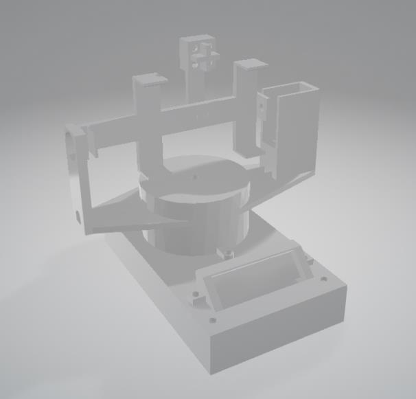 | 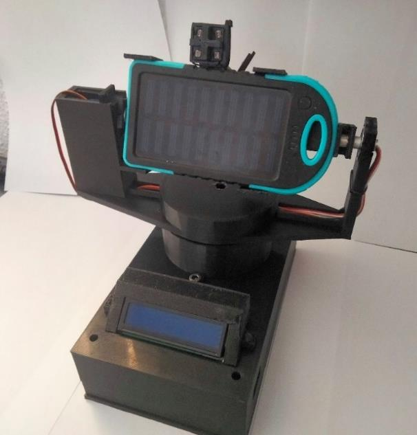 |

---

## 3. Notas de montaje e incidencias documentadas

Según la experiencia recogida en los apartados 3.d y 4 de la memoria:

1. **Mecanizado del tubo de aluminio**: El tubo de 8 mm de diámetro exterior encaja en el rodamiento 22x8 mm del contrapunto. Debe practicarse un recorte longitudinal en el tubo para introducir los cables de las 4 LDR sin que queden atrapados durante el giro de elevación.
2. **Instalación del ampliador (+2 cm)**: Debido a la altura de los cables macho-hembra sobre la placa Arduino y la protoboard, fue necesario añadir la pieza *Ampliador* entre la planta y el cubrecomponentes, rebajando además la altura necesaria para acceder a los puertos laterales de la placa.
3. **Ajuste del soporte LCD**: Las tolerancias reales de la pantalla LCD 16x2 requirieron pequeños recortes manuales sobre el soporte impreso para encajar el módulo correctamente.
4. **Calibración inicial (`LIGHT_THRESHOLD`)**: En `moveSolarTracker()` / `calibrateWithLDR()`, la diferencia mínima entre parejas de LDR para disparar movimiento es `10` unidades ADC (rango `0`-`1023`). Si el cabezal oscila o no responde en interiores con poca luz, ajusta `LIGHT_THRESHOLD` entre `10` y `30` y verifica que las cuatro resistencias del divisor tengan el mismo valor nominal.
